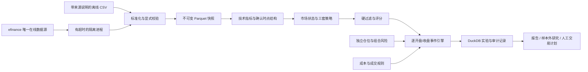

# 架构与数据约定

## 时间与事件

`timestamp` 是信息可用时间，原生小时 / 日线为收盘；周月重采样延迟到日历周期结束。`open_time` 是交易区间起点。所有内部时间必须带时区。相同时间先处理 close 事件，再处理下一根 open 事件。

结构极值的 `pivot_time` 与 `confirmation_time` 分离，算法不能回写旧特征行。右窗口确认完成后下一根才可参与结构突破与 sweep。区域生命周期表包含最终结果，禁止将最终失效状态回灌历史信号。

开盘成交使用已经生成的 Signal；成交量 / 单价格锁定采用保守的 OHLC 执行假设，不能模拟逐笔流动性。所有结果必须披露这些假设。

## 市场规则

资产注册表明确交易单位、tick、乘数、保证金、交易时段、时区、币种、做空许可、交收限制、风险组与行业。未配置资产不能凭代码直接套用股票规则。

夜盘跨午夜的交易日标签、半日市、历史节假日、具体合约主力映射是独立的数据问题。当前没有可靠来源时不宣称这些功能已经验证。连续合约与 FX 转换有硬性拒绝入口。

## 价格与资金

指标价格、成交价格、收益账本分离。不复权是默认执行空间。复权下载可单独研究；价格水平转换要求同时间 OHLC 的有效仿射映射和明确的历史可用性验证。公司行为的股数、分红和期货换月需独立事件，不能靠价格比例替代。

现金记录初始资金、实现 P&L 和所有费用；保证金作为占用额独立记录，不额外扣减净值。净值 = 现金 + 未实现 P&L。退出部分仓位释放相应保证金，成交事件逐笔计算费用。最终交易统计聚合完整持仓的所有退出与持有费用。

## 能力检测和失败处理

数据源失败、空返回、无可用完整周期、数据校验异常分别记录。网络请求运行在单独 Python 进程中，总超时能终止 efinance 内部重试，防止后台线程继续无期限请求。行情只通过 efinance 发起；不切换到其他在线 API。

缓存按资产、周期、复权方式索引；历史内容以哈希不可变保存，manifest 原子替换。增量更新留出七日重叠，重叠处以本次下载替换并重新验证；复权序列不进行新旧拼接。当前实现针对单研究用户，多个进程同时写同一缓存索引可能覆盖最新指针；不可变内容和实验快照仍保留。

## 验证范围

自动测试包括指标算例、无未来数据前缀一致性、结构与区域确认、真实时段聚合规则、三套策略的条件顺序、成交成本 / 手数 / T+1 / 跳空 / 分批止盈 / 做空拒绝、组合限制、价格空间保护、复现、页面交互。

这些测试证明的是可验证的程序行为，不证明策略盈利，也不证明数据供应商覆盖所有市场。在线历史行情实测失败属于外部依赖未满足，交付记录单独披露。
